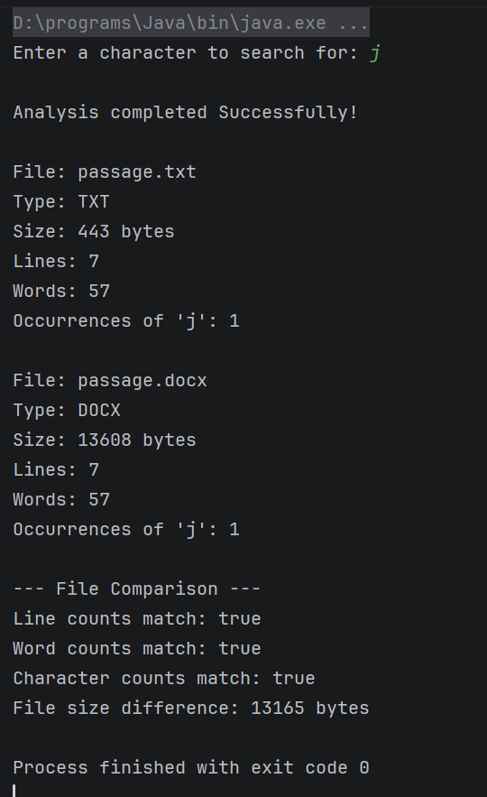

# TextFileAnalyzer

## Description

This Java application analyzes and compares TXT and DOCX files. It calculates file size, line count, word count,
and the frequency of a user-selected character. The program also compares the results and handles errors
involving missing or unsupported files.

## Requirements

- Java 26
- Maven
- Apache POI (managed through Maven)

## Instructions

1. Clone or download the repository.
2. Open the project in IntelliJ IDEA.
3. Allow Maven to download the required dependencies.
4. Ensure passage.txt and passage.docx are located in the project root directory.
5. Run App.java from the com.textfileanalyzer package.
6. Enter a single character when prompted.
7. Review the analysis results and comparison displayed in the console.

## Names of Sample Files

`passage.txt`
`passage.docx`

## Screenshot

